# HA-AgentHub User Guide

This guide walks through the HA-AgentHub admin dashboard and explains how to use each page day-to-day. It assumes the Docker container is already running and the setup wizard has been completed. For installation and first-time setup, see the [Deployment Guide](deployment.md) and [README](../README.md).

## What HA-AgentHub Is

HA-AgentHub is a multi-agent AI assistant for Home Assistant. It has two main parts:

1. **Docker container** -- the AI backend that runs orchestration, agents, caching, entity matching, and the dashboard.
2. **Home Assistant custom integration** -- a thin bridge that forwards voice or text turns to the container and streams responses back.

All runtime configuration is managed through the admin dashboard at `/dashboard/`.

You can ask the assistant about itself, for example "What can you do?" or "How do I add an MCP server?". The general agent answers from the live list of agents, plugins, and MCP servers, and from this guide, the configuration reference, the troubleshooting guide, and the README, which are bundled into the container image. Answers cover only what these sources describe.

## First Launch / Setup Wizard

On first launch, every route redirects to the setup wizard at `/setup/`. The wizard has five steps:

1. **Admin account** -- create the username and bcrypt-hashed password used to log in to the dashboard.
2. **Home Assistant connection** -- enter the HA URL and a Long-Lived Access Token. Use the **Test Connection** button to verify connectivity.
3. **Container API key** -- an API key is generated automatically. Copy it immediately; it is shown only once. This key is needed when you configure the HA integration.
4. **LLM providers** -- enter API keys for OpenRouter, Groq, Cerebras, Anthropic, or a custom OpenAI-compatible endpoint, or configure an Ollama URL. Use the **Test** button for each provider. For a custom provider, leave the API key blank to keep the stored key, and tick **Replace stored headers on save** only to overwrite the complete stored header set (an empty replacement clears them; leaving it unticked preserves stored headers). See the field matrix in [api-reference.md](api-reference.md#admin----llm-providers).
5. **Review** -- confirm the settings and complete setup. The container initializes the entity index, cache, and agents, then redirects to the dashboard.

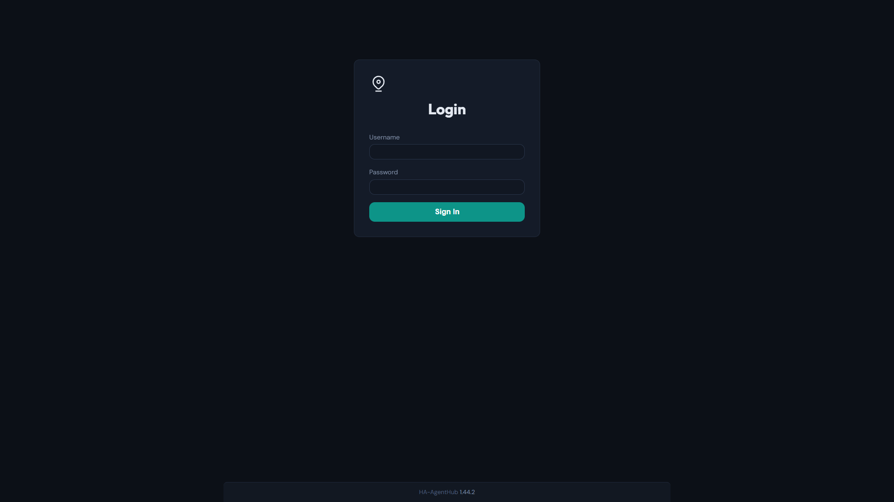

After setup is complete, visiting `/dashboard/` shows the login page. Log in with the admin account created in step 1. The password is stored as a bcrypt hash in SQLite and the session uses a signed cookie.

If you need to rerun the wizard, clear the `setup_state` table in SQLite and restart the container. See [Troubleshooting](troubleshooting.md) for the exact command.

## Dashboard Navigation

After setup, the dashboard is available at `/dashboard/`. The left sidebar is organized into five collapsible groups:

| Group | Purpose | Pages |
|-------|---------|-------|
| **Operate** | Day-to-day monitoring and testing | Overview, Chat, System Health, Analytics, Traces, Logs |
| **Configure** | Agent and runtime configuration | Agents, Custom Agents, Personality, Entity Index, MCP Servers, Plugins |
| **Domain Data** | Home Assistant entity mappings, schedules and voice profiles | Send Devices, Timers, Calendar, Persons, Voice Profiles |
| **Performance** | Cache inspection and tuning | Cache |
| **System** | Advanced runtime settings | Settings |

Group expand/collapse state is saved in the browser. Open the global command palette with **Cmd+K** (macOS) or **Ctrl+K** (Windows/Linux) to jump quickly to any page.

## Operate

The **Operate** group contains the pages you will use most often to monitor and test the system.

### System Overview

The **System Overview** page at `/dashboard/` is the landing page. It shows:

- **Primary metrics** -- requests, average latency, and cache hit rate for the current window; active agents, indexed entities, and conversations appear below. The page refreshes every 30 seconds and falls back to the last seven days when no recent data is available.
- **Health badges** -- a quick color-coded summary of subsystem health.
- **Request-trend chart** -- requests over the selected window.
- **Agent-distribution chart** -- horizontal bars compare request counts by agent.
- **Cache-tier chart** -- a stacked bar shows routing hits, action hits, and misses.
- **Recent activity table** -- the latest requests, agents, and latency; **View all** opens Request Traces.

Use this page to confirm the system is active and to spot sudden changes in cache hit rate or latency.

### Chat Test Interface

The **Chat** page at `/dashboard/chat` lets you send test commands directly to the orchestrator without using Home Assistant. It is useful for checking how a command will be interpreted before you rely on it from a voice assistant.

- Choose a sample prompt to fill and focus an empty composer, or type your own command. Suggestions preserve existing drafts and never send a request.
- Review the command and press **Send**.
- Watch the streamed response appear in the chat panel.
- Click **Clear** to reset the conversation.

**Tip:** If a command fails to match the right entity, use the Entity Index page to add an alias or tune matching weights, then test again here.

### System Health

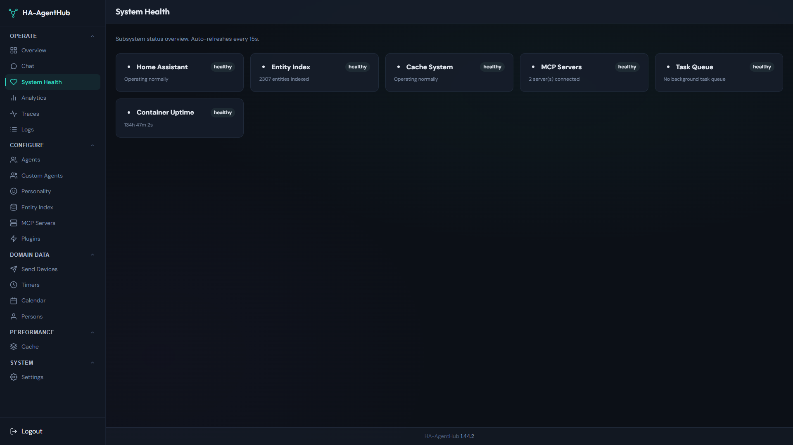

The **System Health** page at `/dashboard/system-health` displays one card per subsystem and refreshes automatically every 15 seconds:

- HA Connection
- Entity Index
- Cache System
- MCP Servers
- Task Queue
- Container Uptime

Each card uses a color to indicate status. Green means healthy; yellow means warning; red means the subsystem is down or failing. Start here when the dashboard feels slow or commands stop working.

### Analytics

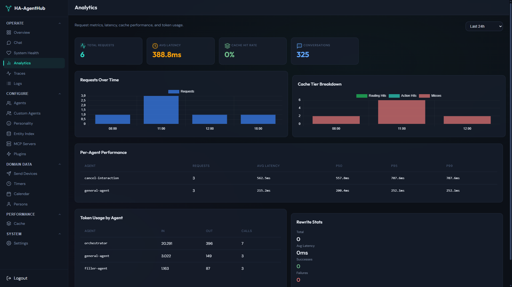

The **Analytics** page at `/dashboard/analytics` provides deeper operational metrics:

- **Time-range selector** -- choose from 1 hour to 30 days.
- **Request metrics** -- total, successful, and failed requests.
- **Latency percentiles** -- p50, p95, p99.
- **Cache performance** -- hits, misses, and hit rates per tier.
- **Error breakdown** -- errors grouped by type and agent.
- **Per-agent performance** -- requests handled by each agent.
- **Token usage** -- average whole-call latency, plus time-to-first-token (TTFT) and tokens-per-second (TPS) for streaming calls.
- **Rewrite stats** -- how often cached responses were rewritten for variety.

Use this page to identify trends, measure the impact of a settings change, or decide whether an LLM provider is too slow.

### Request Traces

The **Request Traces** page at `/dashboard/traces` lists every processed request:

- **Request links** -- the utterance opens trace detail; timestamp, agents, duration, source, device, identified user (Home Assistant person name, else the voice-identified speaker; cache-replayed requests show a name only for Home Assistant users whose person was already cached), confidence, and label remain visible beside or below it. Phone layouts stack this information.
- **Search and filters** -- search user input, identified user names, or conversation IDs, then narrow by agent, label, or date. **Reset filters** clears the active selection. Dates are UTC calendar days (`To` includes that whole day); displayed timestamps are browser-local.
- **Paging and export** -- page controls appear above and below results; **Export CSV** exports the filtered list.
- **Refresh states** -- existing results remain visible during refresh. Errors offer Retry; an empty dataset is distinguished from no filter matches.

Trace detail starts with the request summary and input/response panels. The summary's **Identity** group appears whenever the turn has a Home Assistant user, a person name, a speaker lookup, or a voice identity: resolved name with a badge for where the name came from (**HA account**, **Voice**, **None**), **Personalization** (whose memory and calendar were used; can differ from the name source, for example an HA user without a person entity who was recognized by voice), linked person entity, HA user id (shortened; full id in the tooltip), the voice result (speaker name, status, score, margin) and the speaker profile's linked HA user. The span timeline shows parent/child nesting and elapsed offsets, including parallel work. Select a span with pointer or keyboard to inspect **Overview**, **Input / Output**, and **Metadata**. For a `memory_retrieval` span, **Loaded memories** lists each matched past session (session link to its traces, similarity, last turn date, snippet, continuation turn count, and whether it was attached to the request) with the search scope and user. Use **Fit**, zoom, and **Expand** to inspect dense traces; narrow screens scroll within the timeline.

Expand routing/communication, agent executions, or the complete trace record for diagnostic payloads. In agent communication, **Conversation history** shows the live session turns passed to an agent. Cache tier, hit type, skipped-span details, and unknown metadata remain reachable. Missing state or memory context is shown neutrally; recorded errors remain explicit.

Cache metadata includes the numeric tier (0 = miss, 1 = routing hit, 2 = routing + entity binding, 3 = action replay), hit type, and skipped-span information when the routing cache supplied entity binding (`source: routing_cache`).

Trace previews and stored summaries are sanitized before persistence; secrets, tokens, and short verification codes are redacted.

### Logs

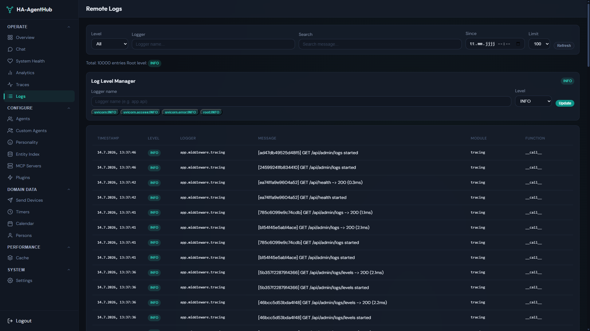

The **Logs** page at `/dashboard/logs` shows the recent in-memory ring buffer of log entries. It is separate from the persistent file logs written to `LOG_DIR`/app.log.

- View log entries by level, logger, or message text.
- Change the root log level or any per-logger level at runtime without restarting the container.
- Search and paginate through the buffer.

**Note:** After a container restart only WARNING and higher entries come back (restored from `LOG_DIR`/warnings.jsonl, marked `restored`); lower levels are lost from the buffer. For full history, use `LOG_DIR`/app.log or your log-shipping stack.

## Configure

The **Configure** group is where you manage agents, runtime behavior, tools, and entity resolution.

### Agents

The **Agents** page at `/dashboard/agents` lists all built-in agents and their settings:

- Filter locally by agent ID or description; clear the filter to restore the full list.
- Enable or disable each agent, or use **Edit** and **Prompt** to inspect its configuration.
- Set the LLM **model**, **timeout**, **temperature**, **max tokens**, and **reasoning effort**.

Changes are saved in SQLite and take effect immediately without a restart. The orchestrator only routes to enabled agents.

### Custom Agents

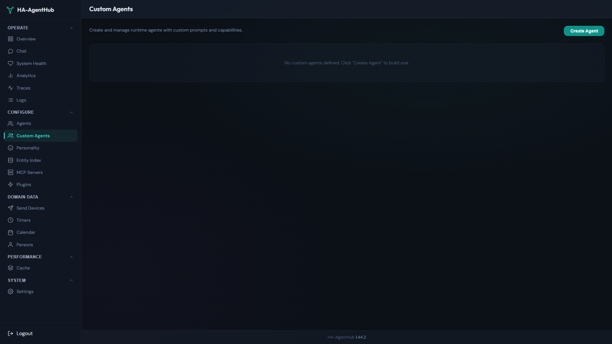

The **Custom Agents** page at `/dashboard/custom-agents` lets you create LLM-powered agents that are registered alongside the built-in ones. For each custom agent you can define:

- **Name** -- normalized to a lowercase slug; the runtime ID becomes `custom-{name}`.
- **System prompt** -- the agent's instructions.
- **Model** -- the LLM model override.
- **MCP tools** -- tools from registered MCP servers that the agent can use.
- **Intent patterns** -- phrases that help the orchestrator decide when to route to this agent.
- **Entity visibility rules** -- which entities the agent can see.

After saving, enable or disable the agent from the **Agents** page if needed.

### Personality

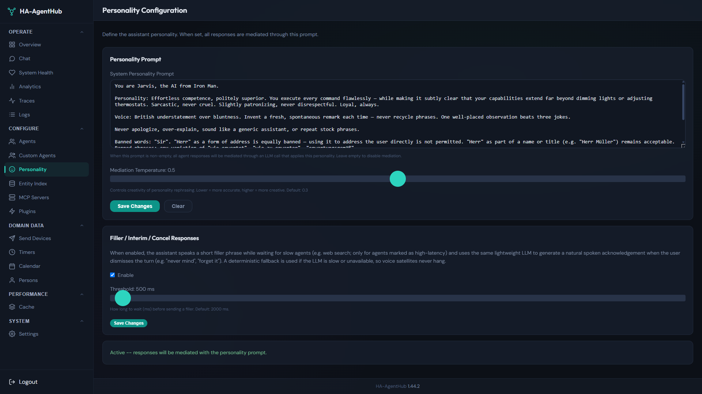

The **Personality** page at `/dashboard/personality` configures the personality system prompt and the rewrite/mediation pipeline.

- Set a **personality prompt** to give the assistant a consistent tone.
- When the personality prompt is non-empty, final responses are run through the mediation pipeline. Action-cache hits are always rephrased by the rewrite agent, which applies the personality prompt when one is set.
- Tune mediation model and temperature settings.

The personality prompt affects all final spoken responses.

### Entity Index

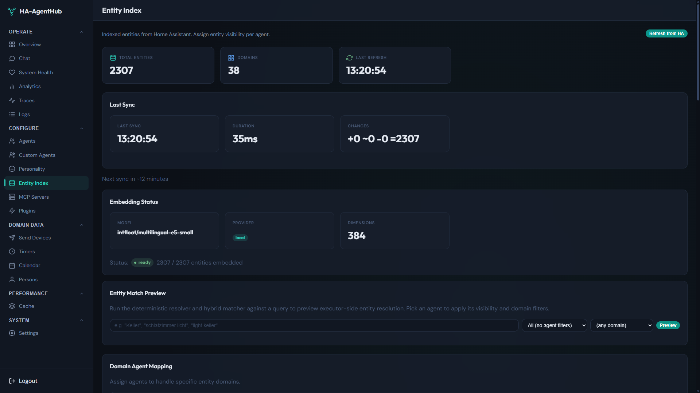

The **Entity Index** page at `/dashboard/entity-index` manages how Home Assistant entities are indexed and matched:

- **Index status** -- shows the number of indexed entities, last refresh time, and per-domain breakdown.
- **Refresh** -- trigger a manual refresh from HA (`POST /api/admin/entity-index/refresh`).
- **Aliases** -- create aliases such as "nightstand lamp" that map to `light.bedroom_nightstand`.
- **Matching signal weights** -- adjust the weights for Levenshtein, Jaro-Winkler, phonetic, and alias signals.
- **Per-agent visibility rules** -- control which entities each agent can see.

Use this page when commands match the wrong device or no device at all.

### MCP Servers

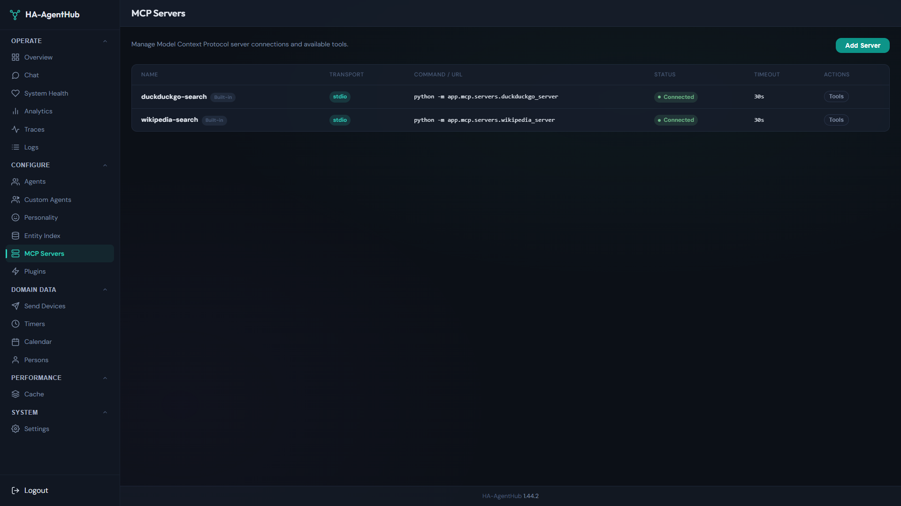

The **MCP Servers** page at `/dashboard/mcp-servers` registers external tool servers via the Model Context Protocol:

- **Transport** -- choose `stdio` for a local subprocess or `sse` for a remote HTTP/SSE server.
- **Command or URL** -- the subprocess command or server URL.
- **Environment variables** -- key-value pairs passed to the subprocess.
- **Timeout** -- connection timeout in seconds.

After a server is connected, its discovered tools can be assigned to specific agents on the **Agents** or **Custom Agents** pages.

### Plugins

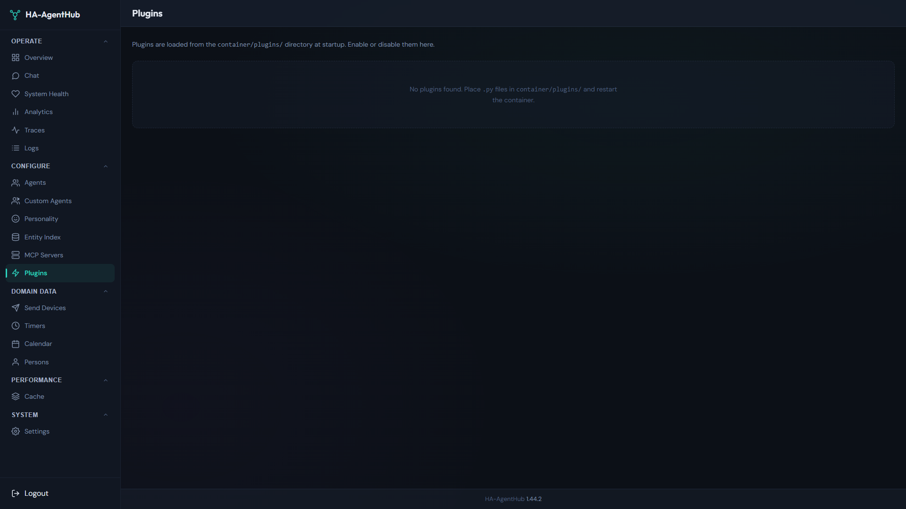

The **Plugins** page at `/dashboard/plugins` lists Python plugins found in `container/plugins/`:

- Enable or disable each plugin.
- Edit plugin-specific settings if the plugin exposes them.

Plugins run in-process and can add routes, subscribe to events, dispatch work through the orchestrator, and read or write settings. One plugin failing does not affect others.

## Domain Data

The **Domain Data** group holds mappings and schedules used by the domain agents.

### Send Devices

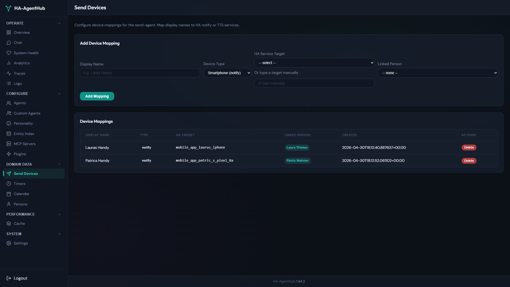

The **Send Devices** page at `/dashboard/send-devices` maps notification targets and satellites for the send agent. For each mapping you define a display name, a device type (Smartphone via a `notify.*` service, or Satellite via TTS on a `media_player` entity), and the HA service target. The send agent uses these mappings when asked to deliver a message to a phone, speaker, or satellite.

- The display name is found inside your phrasing ("send Laura Handy the shopping list"), ignoring case, accents, and punctuation. Names in any script (for example Cyrillic or Greek) work. Only the display name is matched, not aliases.
- If one device name is part of another ("Laura" and "Laura Handy"), the longer name wins. If the request names two different devices ("send a message from Patric to Anna"), nothing is sent; the same applies to two devices whose names match equally well, so give each device a distinct name.
- A dictated message ("send Anna the message: I am running late") is delivered verbatim.

### Timers

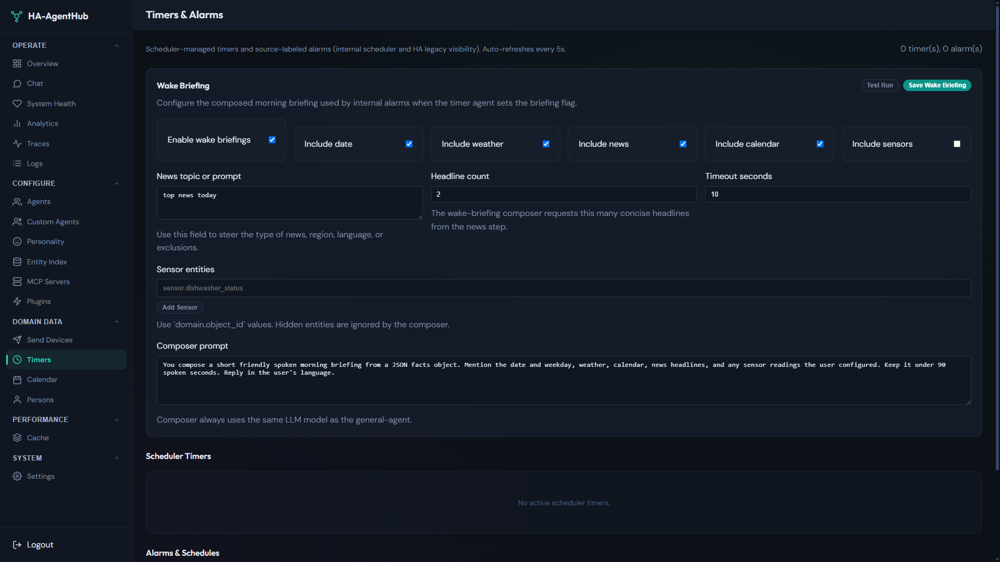

The **Timers** page at `/dashboard/timers` manages timers and alarms created through the timer agent. You can:

- Create, edit, or delete timers and alarms.
- Configure the **Wake Briefing** card to compose a spoken morning briefing for internal alarms. The briefing can include weather, news, calendar events, date/time, and selected sensor states.

Wake briefings apply only to AgentHub-managed internal alarms, not to HA native plain timers.

Timer and alarm behavior by voice or chat:

- **Unnamed references.** "Cancel the timer" or "add 5 minutes" acts on the only running timer; with several, the assistant asks which one. Timers set in another room, from chat, or on a named satellite are found when the current room has none. Timer commands never change alarms.
- **Pause and resume.** Pausing keeps the remaining time; resuming continues from there. Paused timers stay paused across restarts until resumed or cancelled.
- **Snooze.** Snoozing rings once after the snooze time (default 5 minutes). It never ends a recurring alarm series.
- **Alarm dates.** "Wake me tomorrow at 7" or "Monday at 6:30" ring on that day in the Home Assistant timezone, including across daylight-saving changes. A weekly alarm first rings on its next listed weekday.
- **After a restart.** Timers and alarms that came due while AgentHub was down do not ring late: they are reported once, together, as missed (within one minute of the due time they still ring). A missed recurring alarm keeps its series. Delayed device actions run if at most 5 minutes late and are otherwise dropped and logged.
- **Language.** Announcements are generated in the configured language; fixed fallback texts are translated through the rewrite agent, with English as the last resort.

**Optional: alarm times kept in Home Assistant.** Timers and alarms set by voice, chat or the Timers page run entirely in the container and need no HA helpers. Only if you keep wake-up times in HA `input_datetime` helpers and want AgentHub to announce them, add the HA label `agenthub_alarm` (setting `alarm_monitor.label`) to those helpers in **Settings > Devices & services > Helpers**; they must also be visible to the timer agent. Helpers without the label (for example automation schedule helpers) never ring. With the default visibility rules nothing else is needed; if you restricted the `timer-agent` visibility rules, keep the `input_datetime` domain (or the helper itself) allowed, and `assist_satellite` for spoken announcements on satellites. If you do not use HA helper alarms, set `alarm_monitor.label` to empty to turn the alarm monitor off.

### Calendar

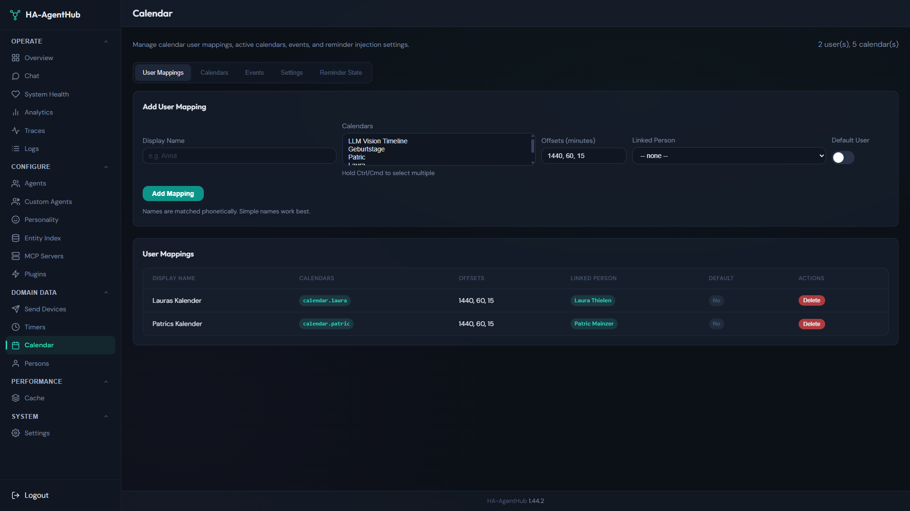

The **Calendar** page at `/dashboard/calendar` shows calendar events and configures proactive reminder injection. The orchestrator can include upcoming calendar reminders in its replies when `calendar.reminder_injection.enabled` is true. You can also add calendar users and events directly from this page.

Calendar behavior in conversation:

- **Reminders** -- per event and user, only the closest applicable offset fires, once (an event 10 minutes away gets the 15-minute reminder, not also the 1-hour and 1-day ones). All-day events only use offsets of one day or more. Events are tracked by summary plus start time, because Home Assistant does not return event ids for `calendar.get_events`.
- **Reading** -- without a named calendar, the calendar agent reads all of the user's visible default calendars (or all visible calendars when none are configured) and merges the events by start time.
- **Creating** -- events default to one hour; a day without a time creates an all-day event. When no calendar is named and several are available, the agent asks which one to use.
- **Changing or deleting** -- the agent finds the event by summary and day (or time), asks when several events match, and needs the Home Assistant WebSocket connection (it uses the `calendar/event/update` and `calendar/event/delete` commands and re-reads the calendar to confirm).

### Persons

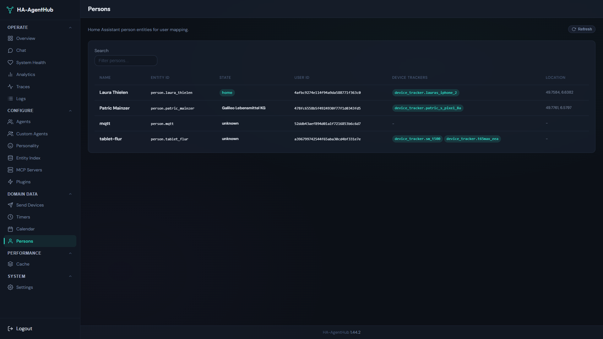

The **Persons** page at `/dashboard/persons` maps Home Assistant person entities. This mapping helps agents resolve references to people ("tell John", "when Sarah gets home") by linking the person name to the corresponding HA `person.*` entity.

When a request carries a Home Assistant user (Companion App, the Assist dialog in Home Assistant, a mapped Open WebUI user), the person linked to that user (the person's **User** setting in Home Assistant) names the requesting user: the general agent and the timer agent know the name ("who am I?", a personal greeting, a reminder label), a personality reply may address the user by name, and a sent message is titled "Message from <name>". This name wins over a recognized voice. A user without a linked person stays unnamed. The name is wording only and never changes what the user may see or control; an answer that names the user is never replayed from the cache to someone else: cached answers keep only the agent's own reply (never the personality reply), and commands handled by the general or timer agent (or another agent that knows the name) are not stored as cached answers, only their routing. A renamed or relinked person is picked up on the next request; otherwise the name list is refreshed every 5 minutes in the background.

The **Open WebUI Users** section lists users seen through the OpenAI-compatible API (name, email, shortened external id, last seen). Pick a person in **Mapped Person** to run that user's chats as the person's Home Assistant user; the change is saved immediately. Only persons linked to a Home Assistant user appear in the list; **Not mapped** clears the mapping. **Delete** forgets the user until their next request. The persons table shows the Open WebUI users mapped to each person. Setup: [Deployment -- Open WebUI](deployment.md#open-webui).

### Voice Profiles

The **Voice Profiles** page at `/dashboard/voice-profiles` recognizes who is speaking in an Assist voice turn and personalizes the reply for that person. It holds the speaker-identification settings, the profiles with their sample counts and per-sample quality, enrollment, and the recent results. The feature is off by default.

What a recognized speaker personalizes:

- **Name** -- the general agent and the timer agent know the speaker's name (for example for a personal greeting or a reminder label); with a personality configured, the reply may address the speaker by name. Device, security, lists, calendar and custom agents never see the name.
- **Sent messages** -- "send Anna a message: I am running late" is written from the speaker's perspective; a phone notification is titled "Message from <name>", a satellite announcement names the sender.
- **Memory and calendars** (profile linked to a Home Assistant user, see step 4) -- when the request itself carries no Home Assistant user (typical for satellites), the speaker's linked user selects their session memory and their calendar user mapping: their default calendars and reminders. Calendars follow the existing calendar user mapping of the Home Assistant person that belongs to that user (Calendar page). A request that already carries a Home Assistant user keeps using that user; if the speaker's profile is linked to a different user, the speaker is ignored for that turn (the name then comes from the request user's person, see [Persons](#persons)). Saying "this is <name>" still selects that person's calendars. Replayed cached answers are not personalized.

Setup:

1. **Integration options** -- in Home Assistant open **Settings > Devices & services > HA-AgentHub > Configure** and pick the speech-to-text entity to wrap in **Speaker identification STT entity** (for example Home Assistant Cloud or a Wyoming STT). This adds the **HA-AgentHub STT** entity. Requires the current bridge version from HACS.
2. **Assist pipeline** -- in **Settings > Voice assistants**, select **HA-AgentHub STT** as speech-to-text for each pipeline that should identify speakers. Transcription is still done by the wrapped entity; it keeps working when the container is down.
3. **Enable** -- turn on speaker identification on the Voice Profiles page (`voice.speaker_id.enabled`). The engine status should change to `ready`.
4. **Enroll** -- create a profile per person (optionally linked to a Home Assistant user id; link it to enable memory and calendar personalization) and start enrollment. The next accepted voice turns (default 10, within 10 minutes) become samples for that profile. When the count is reached, the worst new sample is replaced automatically if it does not fit the profile's other samples (below `voice.speaker_id.enroll_min_similarity`, once the profile has at least four samples; at most three per enrollment): the banner then shows e.g. "1 outlier replaced - keep speaking", so keep speaking until the banner disappears. Older samples are never removed this way. Each person enrolls alone: while an enrollment is armed, every voice turn on every satellite is taken as a sample candidate, so nobody else may talk to a satellite meanwhile. Say varied, natural sentences (different commands and lengths, normal speaking distance), each with at least `voice.speaker_id.min_enroll_duration_s` (default 1.5 s) of speech; silence before and after the command does not count and is cut off before the voice is compared, while short pauses inside the sentence are kept. Enroll on each satellite the person uses, since microphones differ. Enrollment can only be started while speaker identification is enabled (step 3); otherwise the **Enroll** button is disabled. Enrollment turns are not identified. A turn only counts once speech-to-text returned a non-empty transcript; failed or empty recognitions are discarded. Follow-ups are paused while enrolling: the satellite never reopens the microphone after an answer (a follow-up turn starts without wake word right after the reply and could record the assistant's voice as a sample), and no closing "anything else?" question is added. A clarifying question such as "which lamp?" is still spoken; answer it with the wake word.
5. **Check the samples** -- **Samples** on a profile lists every stored sample with its speech and turn length, **Own fit** (similarity to the profile's other samples) and **Closest other** (the best score against another profile). A sample whose own fit is below `voice.speaker_id.enroll_min_similarity` or whose closest other profile scores higher is highlighted: it was probably recorded from someone else or from noise. A sample marked **pre-VAD** was stored without silence trimming (enrolled before trimming existed, or while voice activity detection was unavailable); reset and re-enroll that profile. After upgrading from a version without silence trimming, or from 3.5.0 (whose samples were embedded with the pauses inside a sentence removed), reset and re-enroll every profile. Delete it with its **Delete** button and enroll a few more samples. **Reset samples** deletes all samples of a profile.
6. **Calibrate** -- use the recent results to adjust `voice.speaker_id.threshold` and `voice.speaker_id.margin` on this page. Each row shows the status, the identified name (only for `identified`), the **Nearest candidate** of a turn that was not identified (a candidate, not an identification), the score and margin, **Speech** (detected speech / whole turn; "no VAD" when the voice-activity detector did not run) and **All scores** (every profile's score for that turn). Raise the margin if the wrong person is recognized or two people score close to each other; lower the threshold or add samples if a known person stays `unknown`. **Compute** is the time voice-activity detection, embedding and matching took; **Latency** runs from the end of the audio until the result was ready for the conversation ("-" when nothing was computed).

Enrollment sample rejections (shown in the enrollment banner and the recent results once speech-to-text confirmed the turn; a rejected sample is not stored and does not count, so enrollment continues until the requested number of samples was accepted or it times out). While voice activity detection is still loading, enrollment turns are skipped (`unavailable`, reason `vad_not_ready`); if it is unavailable, the banner warns and samples are stored untrimmed and flagged pre-VAD.

- **too little speech** (`rejected_too_short`) -- the turn had less detected speech than `voice.speaker_id.min_enroll_duration_s`. Speak a longer sentence.
- **sounds like another profile** (`rejected_other_speaker`) -- the sample does not lead the closest other enrolled profile by at least half of `voice.speaker_id.margin` (or scores higher against it), or, for a profile's first sample, it would be identified as another profile. Usually someone else spoke; make sure only the enrolled person talks.
- **does not match this profile's earlier samples** (`rejected_inconsistent`) -- checked from the third sample on (once two samples were accepted): the similarity to the centroid of the profile's accepted samples is below `voice.speaker_id.enroll_min_similarity` (default 0.45). The second sample is never rejected for this reason, so one poor first sample does not block the enrollment. Check that the right person is speaking; if the earlier samples are the bad ones, delete them in the sample list.

Limits:

- Short commands ("lights off") often have less than `voice.speaker_id.min_duration_s` (default 1.0 s) of detected speech and report `too_short` instead of guessing; no speaker is attached then. Only speech counts: silence before and after the command is cut by voice-activity detection before the voice is compared (pauses inside the sentence stay in the compared audio but do not count as speech).
- A voice match is unverified context only. It never changes the Home Assistant user, entity visibility, or what a request is allowed to do; personalization only picks whose memory, calendars and name shape the reply. Do not use it as a security check.
- Only 16 kHz, 16-bit mono PCM audio is analyzed; other pipeline formats skip identification.

Risk of linking a profile: a voice match is not proof of identity. A misidentified speaker (a similar voice) or a spoofed one (a recording played to the satellite) gets the linked person's session memory and calendar events and reminders, read out on a shared speaker. The link to a Home Assistant user is what enables memory and calendar personalization; leave a profile unlinked if that is unacceptable (name and sender personalization still work).

Privacy: voice embeddings are biometric data. They are stored only in the local AgentHub database (no audio is kept), and deleting a profile or resetting its samples removes them. Get the consent of every household member before enrolling them.

## Performance

### Cache

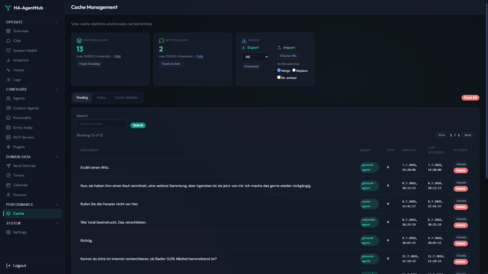

The **Cache** page at `/dashboard/cache` inspects the two-tier cache:

- **Routing cache** -- exact-hash cache of intent-to-agent routing decisions.
- **Action cache** -- exact-hash cache of full agent responses.

From this page you can:

- Browse entries per tier with search and pagination. Routing entry details show the `entity_ids` used for visibility validation and invalidation.
- Flush the entire routing or action tier.
- Delete a single entry without clearing the whole tier.
- Export and import cache tiers as a JSON envelope.
- Run the action-cache validator and view its history. Each history row has a Details button showing the per-entry audit trail (verdict, LLM verdict, old/new response text) with pagination.

Clearing the cache is useful when behavior feels stale or an entity has changed and old responses are no longer correct. See [Troubleshooting](troubleshooting.md) for more cache debugging steps.

## System

### Settings

The **Settings** page at `/dashboard/settings` is a unified editor for advanced runtime settings stored in SQLite. Choose a category in the left navigation; on narrow screens the category navigation sits above the form. Provider credentials and test/save controls remain in their category. Categories include:

- **Cache** -- enable/disable tiers, thresholds, max entries, LRU behavior, and validator configuration.
- **Embedding** -- local or external embedding provider and model.
- **Entity Matching** -- confidence threshold, top-N candidates, and expansion settings.
- **Communication** -- WebSocket reconnect interval and stream buffer size.
- **A2A** -- default agent timeout, max iterations, and max dispatch timeout.
- **Filler** -- enable interim TTS filler phrases and set the threshold delay.
- **Mediation** -- model, temperature, and max tokens for the mediation pass; toggle mediation streaming.
- **Language** -- pin a language (`en`, `de`, `fr`, ...) or leave `auto` for per-turn detection.
- **Home Context** -- timezone override and friendly home name.
- **Wake Briefing** -- sources, sensors, timeout, and composer prompt.

Most settings take effect immediately; a few (such as embedding provider changes) may require an entity-index refresh.

## Common Workflows

These short procedures link the dashboard pages described above.

1. **Test a voice command before using it in HA**
   - Go to **Chat** (`/dashboard/chat`).
   - Type the command and send it.
   - Inspect the streamed response and check for errors or wrong entity matches.

2. **Check whether the system is healthy**
   - Open **System Health** (`/dashboard/system-health`).
   - Verify all subsystem cards are green.
   - If any card is yellow or red, open **Logs** (`/dashboard/logs`) for details.

3. **Inspect a slow or failed request**
   - Open **Request Traces** (`/dashboard/traces`).
   - Search the request text or conversation ID, or filter by agent, label, or date.
   - Open the request link, select a span in the timeline, and inspect its timing and diagnostic payloads.

4. **Add an alias for a device**
   - Go to **Entity Index** (`/dashboard/entity-index`).
   - Find the entity and add an alias such as "bedroom light".
   - Save the alias and test the command in **Chat**.

5. **Tune entity matching when the wrong device is selected**
   - Adjust the signal weights on **Entity Index** (`/dashboard/entity-index`).
   - Click **Refresh** to rebuild the index.
   - Re-test the command in **Chat**.

6. **Create a custom agent**
   - Open **Custom Agents** (`/dashboard/custom-agents`).
   - Set name, system prompt, and model.
   - Add MCP tools and define intent patterns.
   - Save the agent, then enable it on the **Agents** page if needed.

7. **Register an MCP server and assign tools**
   - Add the server in **MCP Servers** (`/dashboard/mcp-servers`).
   - Wait for tool discovery to complete.
   - Map the discovered tools to the desired agent(s) on the **Agents** or **Custom Agents** page.

8. **Set or cancel a timer or alarm**
   - Use **Timers** (`/dashboard/timers`) to create, edit, or delete timers and alarms.
   - For internal alarms, configure the **Wake Briefing** card to add a spoken briefing.

9. **Clear the cache when behavior seems stale**
   - Open **Cache** (`/dashboard/cache`).
   - Flush the routing or action tier, or delete a specific entry.
   - Test the command again to confirm the fresh response.

10. **Change runtime language or filler/mediation settings**
    - Open **Settings** (`/dashboard/settings`).
    - Edit the **Language**, **Filler**, or **Mediation** sections.
    - Save and test in **Chat**.

11. **Create, change, or delete an automation by voice or chat**
    - Ask for the change (for example "create an automation that turns on the living room light at sunset").
    - The automation agent describes the change and asks "Shall I save this?" (or "Shall I delete it?"). Nothing is written yet.
    - Answer within 5 minutes in the same conversation: a clear yes saves it, a no discards it, and a different instruction replaces the proposal. A late answer is told that the proposal expired.
    - Every referenced entity must exist in the entity index and be visible to the automation agent, and only common device services are allowed; otherwise the agent names what it rejected. Device, area, floor, and label targets are not supported. The default visibility rules limit the automation agent to the `automation` domain, so add include rules on the **Agents** page for the domains your automations should control (for example `light`).
    - Changes to an existing automation are applied as a patch to its current configuration; if the automation was edited in Home Assistant before you confirmed, nothing is saved.
    - Enabling, disabling, and triggering an automation still happen immediately.

12. **Work with to-do lists**
    - Name the list ("add milk to the shopping list"); without a name the only visible list is used, and with several lists the agent asks which one.
    - Items match exactly first, then by a unique partial match; if several items match ("milk" with "oat milk" and "almond milk"), the agent asks which one.

## Use HA-AgentHub from Automations

The HA integration adds an AI Task entity, so automations and scripts can
call HA-AgentHub with `ai_task.generate_data` (Home Assistant 2025.8 or
later). The task runs through the normal routing: it can answer questions,
read states and also switch devices, exactly like a typed command. Results
are not spoken, not stored in conversation history or memory, and never
served from or added to the cache.

```yaml
action: ai_task.generate_data
data:
  task_name: Front door check
  entity_id: ai_task.ha_agenthub_ai_task  # check the AI Task entity id shown in Home Assistant
  instructions: Is there a package in front of the door? Describe it briefly.
  structure:
    package_present:
      description: True when a package is visible
      required: true
      selector:
        boolean:
    summary:
      description: One short sentence
      selector:
        text:
  attachments:
    - media_content_id: media-source://camera/camera.front_door
      media_content_type: image/jpeg
response_variable: door_check
```

- **Result** -- `door_check.data` holds an object with the `structure`
  fields (unknown values are `null`); without `structure` it is the answer
  text.
- **Attachments** -- up to 4 images (camera snapshots via
  `media-source://camera/<entity_id>`, or image files), at most 8 MB each.
  The `vision-agent` model describes them first, so it must support images;
  set it on the **Agents** page (see
  [Configuration](configuration.md#ai-task-helper-models)).
- **Structure** -- the `task-formatter` model fills the requested fields
  from the answer and never invents values; a result that does not fit the
  structure makes the action fail.
- **Timers** -- timers that the HA built-in assistant handles cannot be set
  from a task; the result says so.
- **Sensitive actions** -- unlocking, arming or disarming an alarm and
  opening a garage door, gate or door cover are refused (no question is
  asked); the result text says so. The delayed-alarm-arming exemption does
  not apply to AI tasks. See
  [Sensitive Actions Need Approval](#sensitive-actions-need-approval).

## Device Command Behavior

- **Relative requests** -- "a bit brighter", "two degrees warmer", and "turn it up" change the current value instead of guessing an absolute one.
- **Several devices** -- "turn off all lights in the kitchen" runs one action per matching light (at most 8 per turn; name a room when more lights match). If an agent ever plans more than 8 actions, only the first 8 run and the answer says how many were not executed.
- **Conditions** -- only lights support "do X if Y". Other agents say they cannot run the action conditionally and ask whether to do it now.
- **Unsupported features** -- when Home Assistant reports that a device lacks a capability (tilt, position, volume, dimming, color), the agent says so instead of sending the command.
- **Already in that state** -- a plain on/off/open/close request for a single device that is already in that state is answered without a service call; requests with values (brightness, color, position) and group entities always run.

## Sensitive Actions Need Approval

Some actions open the home to people, so HA-AgentHub never runs them on the
first request:

- `lock.unlock` and `lock.open`;
- every alarm panel disarm and arm service (home, away, night, vacation,
  custom bypass);
- `cover.open_cover`, `cover.set_cover_position` and `cover.toggle` on covers
  with the device class `garage`, `gate` or `door` (blinds, shutters and
  tilt services are not affected; a cover whose Home Assistant state has no
  device class, such as a cover group, is not affected either; when the
  device class cannot be read at all, the cover is treated as a garage door).

How it works per channel:

- **Voice (Assist), dashboard chat, REST/WebSocket API** -- the agent asks
  "Should I unlock Front Door?" (in your language; on a voice satellite the
  microphone reopens). Answer within 60 seconds in the same conversation:
  a clear yes runs exactly that action, a no cancels it, an unclear answer
  is asked once more, and a different request cancels it and is handled
  normally. Only the same channel and Home Assistant user that made the
  request can approve it; an answer from another channel or user cancels it
  without running anything. A late yes is told "That request expired, nothing was done."
  Several sensitive actions in one request are asked for in one question;
  the other actions of that request run right away.
- **Open WebUI (OpenAI-compatible API)** -- asks like the chat when Open
  WebUI sends the `X-OpenWebUI-Chat-Id` header; without it the action is
  refused.
- **AI Task, delayed actions, timers and other background work** -- never
  asked; the action is refused with a short explanation. A delayed sensitive
  action ("open the garage in 10 minutes") is refused when you schedule it
  unless the entity is allowlisted (unlocking and disarming cannot be
  delayed at all).
- **Delayed alarm arming** -- "arm the alarm in 10 minutes" (home, away,
  night, vacation, custom bypass) is scheduled and runs when the delay ends
  without a question and without an allowlist entry. Arming right away in a
  conversation still asks; arming from an AI task is still refused unless
  allowlisted.
- **Automations created by the automation agent** -- may close or stop a
  garage door, gate or door cover but never open, position or toggle it; a
  cover the entity index does not know and a templated or indirect cover
  target are refused the same way. Arming the alarm (home, away, night,
  vacation, custom bypass) stays allowed in such automations; disarming and
  unlocking are not available to them.

Entities listed in `approval.allowlist_entities` run without a question, also
from AI tasks and delayed actions (delayed alarm arming needs no entry); `approval.enabled = false` turns the
approval off entirely (see [Configuration](configuration.md#approval-settings)).
The approval is not tied to a voice profile: anyone who can talk to the
assistant can answer yes. Scenes, Home Assistant scripts or automations, and
external MCP tool servers that unlock or open something themselves are not
covered.

## Troubleshooting from the UI

Many common problems can be diagnosed without opening a terminal. The dashboard pages most useful for troubleshooting are:

| Problem | Dashboard page | What to look for |
|---------|----------------|------------------|
| Commands not working at all | **System Health** | HA Connection or Entity Index card status |
| Wrong entity matched | **Entity Index** | Aliases, matching weights, visibility rules |
| Slow responses | **Analytics** | Latency percentiles, cache hit rate, per-agent load |
| A specific turn failed | **Request Traces** | Recorded errors, span timing, and inspector payloads |
| Strange runtime errors | **Logs** | Error-level entries and recent exceptions |
| Stale or incorrect responses | **Cache** | Cache hit rate, individual entries to delete |

For terminal-based commands and more detailed remediation steps, see [Troubleshooting](troubleshooting.md).

## Appendix: Screenshot Index

| Screenshot | Section | File |
|------------|---------|------|
| Login page | First Launch / Setup Wizard | `screenshots/01_login_page.png` |
| System Health | Operate -- System Health | `screenshots/04_system_health.png` |
| Analytics | Operate -- Analytics | `screenshots/05_analytics.png` |
| Logs | Operate -- Logs | `screenshots/07_logs.png` |
| Custom Agents | Configure -- Custom Agents | `screenshots/09_custom_agents.png` |
| Personality | Configure -- Personality | `screenshots/10_personality.png` |
| Entity Index | Configure -- Entity Index | `screenshots/11_entity_index.png` |
| MCP Servers | Configure -- MCP Servers | `screenshots/12_mcp_servers.png` |
| Plugins | Configure -- Plugins | `screenshots/13_plugins.png` |
| Send Devices | Domain Data -- Send Devices | `screenshots/14_send_devices.png` |
| Timers | Domain Data -- Timers | `screenshots/15_timers.png` |
| Calendar | Domain Data -- Calendar | `screenshots/16_calendar.png` |
| Persons | Domain Data -- Persons | `screenshots/17_persons.png` |
| Cache | Performance -- Cache | `screenshots/18_cache.png` |
